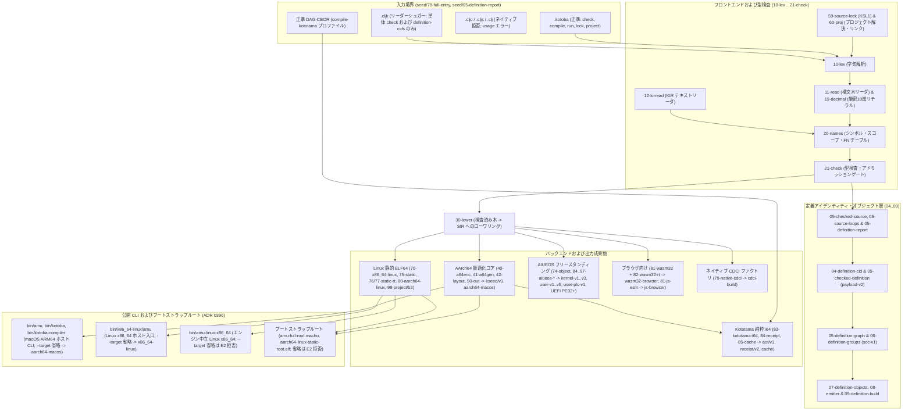

# Amu コンパイラ・アーキテクチャおよび一次実測メトリクス

[English (Canonical)](compiler-architecture.md)

> **実測ベースライン**
> - **対象リポジトリ**: `kotoba-lang/amu`
> - **実測 `origin/main` コミット**: `87ec570aff47a0a21b4876fcda4fa9d4e3b934fb` (`87ec570af`)
> - **実測日**: `2026-11-27`
> - **計測方針**: 本書のモジュール数・行数・定義数・バイト数・SHA-256 ダイジェスト・カバレッジ上下界・言語ラダー集計はすべて `origin/main` (`87ec570af`) の作業ツリーから各節記載の再現可能な相対パスコマンドで一次実測した値である。第 5 節の実行性能記録はリポジトリ内の履歴アーカイブから直接参照したものであり、現行コンパイラの適格性評価とは厳格に分離している。

---

## 1. パイプラインおよびレイヤー構成

Amu は開発中の Kotoba Lisp マシン向けネイティブ・セルフホストコンパイラである。完全版コンパイラバイナリは [`seed/FULL-MANIFEST`](../seed/FULL-MANIFEST) に列挙された 61 モジュールを単一連結（unity 順）で結合して構築される。採択済みの 18 モジュールコア（[`seed/MANIFEST`](../seed/MANIFEST)、[ADR 0370](adr/0370-embench-measured-compiler-core.md)）を中核に、定義アイデンティティ（Definition CID）、ローダーレス Linux エミッタおよび静的ランタイム、AIUEOS フリースタンディング・カーネル／ユーザー／UEFI ブート経路、ブラウザ向け Wasm32 / 制限付き JS ESM エミッタ、Kototama 純粋 i64 AOT／レシート／キャッシュプロファイル、ネイティブ CDCI を統合している。

### 入力・リーダーシュガー境界

[`AGENTS.md`](../AGENTS.md) の規定および [`seed/78-full-entry.kotoba`](../seed/78-full-entry.kotoba)・[`seed/05-definition-report.kotoba`](../seed/05-definition-report.kotoba) の実装で確認した現在の入力境界は次のとおりである。

- **正準ソース (`.kotoba`)**: `compile`、`run`、`--source-lock`、およびマルチモジュール・プロジェクト経路すべてで必須。
- **リーダーシュガー (`.cljk`)**: 同一フロントエンドを通る次の 2 つの単体検査コマンドのみネイティブ受理される（`dsr-source-input?` / `full-source-ok?`）：
  - `check FILE.cljk`（`argc == 2` の単体実行のみ。ロック／プロジェクト指定時は不可）
  - `definition-cids FILE.cljk [--groups]`（ADR 0300 定義アイデンティティ報告）
  - `.edn` には現時点でネイティブ入口が存在しない。
- **ネイティブ拒否入力 (`.cljc` / `.cljs` / `.clj`)**: ネイティブコンパイラでは usage エラーとして拒否される。ネイティブのビルドおよび実行閉包には一切入らず、ローカル参照オラクルまたは別枠のホスト CI ツール用途に限定される。

### コンパイラおよびランタイム全体データフロー



### 公開エントリポイント・コマンド・ターゲット一覧（`ADR 0396`）

[`seed/78-full-entry.kotoba`](../seed/78-full-entry.kotoba)、[`native-product.json`](../native-product.json)、[`seed/bootstrap/aarch64-macos/cli.json`](../seed/bootstrap/aarch64-macos/cli.json)、[`seed/bootstrap/aarch64-macos/root.json`](../seed/bootstrap/aarch64-macos/root.json) で確認した実測一覧：

- **`seed/78-full-entry.kotoba` がディスパッチする明示 `--target` 値**:
  - コア AArch64: `aarch64-macos`（`90-drv` 経由）
  - ローダーレス Linux ELF64: `x86_64-linux`（フォーマット: 既定/`static`、`host-entry`、`kx64-runner`、`launcher`、`b2`。`--format platform-linked` は公開ネイティブ入口で明示 `E2` 拒否）、`aarch64-linux`
  - フリースタンディング AIUEOS: `x86_64-aiueos-kernel-v1`、`x86_64-aiueos-kernel-v2`、`x86_64-aiueos-kernel-v3`、`x86_64-aiueos-user-v1`、`x86_64-aiueos-user-v2`、`x86_64-aiueos-user-v3`、`x86_64-aiueos-user-v4`、`x86_64-aiueos-user-v5`、`x86_64-aiueos-user-plc-v1`
  - ブラウザ: `wasm32-browser`、`js-browser`
- **その他のトップレベルコマンド（`seed/78-full-entry.kotoba`・`seed/90-drv.kotoba`）**:
  - `check`、`compile`、`extract-native`、`compile-kir`、`link`、`modules`
  - `definition-cids <file.kotoba|file.cljk> [--groups]`
  - `compile-kototama`（`kototama.pure-i64-aot/v1` および `kototama.pure-i64-receipt/v2`）、`compile-kototama-cache`、`kototama-cache-host-build`
  - `cdci-build`、`bench-build`、`package-aiueos-boot`、`package-aiueos-user-payload`

| エントリポイント／ルートパス | エイリアス | 形式・サイズ（バイト） | `--target` 省略時の挙動（ADR 0396） |
| --- | --- | --- | --- |
| `bin/amu` → `seed/bootstrap/aarch64-macos/amu-cli.macho` | `bin/kotoba`、`bin/kotoba-compiler` | Mach-O ARM64 (`2,907,488`) | `aarch64-macos` 向けにコンパイル・実行（有界ホスト CLI。明示 `--target` は usage エラー。内部で `amu-full-root.macho` `3,925,280` B と `kotoba-packager-root.macho` `182,432` B を起動） |
| `bin/x86_64-linux/amu` | `bin/x86_64-linux/kotoba`、`bin/x86_64-linux/kotoba-compiler` | ローダーレス静的 ELF64 (`10,695,168`) | `--target` 省略の `compile SRC ...` を `--target x86_64-linux` として解釈（`--format host-entry`。明示指定時は中立コンパイラと同一動作。`native-product.json` 上 `nativeQualified: false`） |
| `bin/amu-linux-x86_64` | `bin/kotoba-linux-x86_64`、`bin/kotoba-compiler-linux-x86_64` | ローダーレス静的 ELF64 (`10,691,072`) | エンジン中立コンパイラ。`--target` 省略は `E2` 拒否 |
| `seed/bootstrap/aarch64-macos/amu-full-root.macho` | — | Mach-O ARM64 (`3,925,280`) | エンジン中立ルート。`--target` 省略は `E2` 拒否 |
| `seed/bootstrap/aarch64-linux-static-root.elf` | — | ローダーレス静的 ELF64 (`4,186,624`) | エンジン中立ルート。`--target` 省略は `E2` 拒否（Linux ARM64 の公開製品入口は未整備） |

再現コマンド:
```sh
ls -la bin/ bin/x86_64-linux/ seed/bootstrap/aarch64-macos/*.macho seed/bootstrap/aarch64-linux-static-root.elf
```

---

## 2. モジュールおよびコード規模インベントリ（`seed/FULL-MANIFEST` と周辺層）

### 計測ルールの定義

- **行数（LOC）**: ファイルの物理行数（`text.count("\n") + (0 if text.endswith("\n") or not text else 1)`）。
- **トップレベル定義数（defs）**: 行頭アンカー付き正規表現 `^\((?:defn-?|def)\s+([^\s\(\)\[\]]+)` で集計（行頭から始まる `defn`、`defn-`、`def` の総数。`76-x86_64-static-rt.kotoba` および `77-aarch64-static-rt.kotoba` の文字列リテラル内に埋め込まれた行頭 `defn-` 定義も含む）。
- **単一連結（Unity）サイズ**: `seed/FULL-MANIFEST` の 61 モジュールを記載順に連結し各末尾に `\n` を付与（`b"\n".join(...) + b"\n"`）すると **4,102,044 バイト**（生バイト合計 `4,101,983` + 改行 `61` バイト）となり、[`docs/qualification/qualifier-native-20261108.json`](qualification/qualifier-native-20261108.json) および [`native-product.json`](../native-product.json) の SHA-256 `90f489962f63d73e8595b84eb39afe73047d787df078d6325a8521f5b10f1981` と完全一致する。

> **モジュール数表記の整合について**: `origin/main` の `seed/FULL-MANIFEST` は **61 モジュール**（`native-product.json` および `docs/qualification/qualifier-native-20261108.json` の `sourceModuleCount: 61` と一致）。旧記述が残っていた `README.md`（`49-module`）は今回の更新で整合済みである。なお `AGENTS.md` 中の `47`/`48` モジュール記述は拡張前の履歴表現である。

### `seed/FULL-MANIFEST` 責務レイヤー別インベントリ（61 モジュール）

| 責務レイヤー | ファイル数 | LOC | 定義数 | 生バイト数 | バイト構成比 |
| --- | ---: | ---: | ---: | ---: | ---: |
| **1. 採択コア**（`00-ns-static`..`03`, `10`..`12`, `19`..`21`, `30`, `40`..`42`, `50`, `59`..`60`, `90`） | 18 | 44,831 | 5,965 | 2,991,042 | 72.92% |
| — *1a. 静的 NS・メモリ・IO・SHA-256*（`00-ns-static`, `01-mem`, `02-io`, `03-source-sha256`） | *4* | *1,264* | *804* | *46,058* | *1.12%* |
| — *1b. フロントエンド（字句・構文・KIR・10進・名前・型検査）*（`10`, `11`, `12`, `19`, `20`, `21`） | *6* | *12,855* | *1,595* | *768,157* | *18.73%* |
| — *1c. SIR ローワリング*（`30-lower`） | *1* | *1,691* | *201* | *93,717* | *2.28%* |
| — *1d. AArch64 バックエンド・レイアウト・`kseed/v1` 出力*（`40`, `41`, `42`, `50`） | *4* | *26,283* | *3,005* | *1,914,274* | *46.67%* |
| — *1e. ソースロック・プロジェクトリンカ・コアドライバ*（`59`, `60`, `90`） | *3* | *2,738* | *360* | *168,836* | *4.12%* |
| **2. 定義アイデンティティ・検査済みソース橋渡し・オブジェクトビルド**（`04`, `05-*`, `06`, `07`, `08`, `09`） | 10 | 2,657 | 319 | 176,533 | 4.30% |
| **3. ネイティブ Linux エミッタ・ランタイム・プロジェクト・B2**（`70`..`73`, `75`..`78-platform`, `80`, `98-project`, `98-b2`） | 11 | 7,552 | 1,117 | 487,594 | 11.89% |
| **4. AIUEOS フリースタンディング・カーネル／ユーザー／ValueRuntime／UEFI ブート**（`74`, `84`..`89`, `91`..`97`） | 14 | 4,443 | 592 | 299,585 | 7.30% |
| **5. ブラウザターゲット（Wasm32 および制限付き JS ESM）**（`81-wasm32`, `82-wasm32-rt`, `81-js-esm`） | 3 | 1,263 | 222 | 86,616 | 2.11% |
| **6. Kototama 純粋 i64 AOT・レシート・キャッシュ**（`83`, `84-receipt`, `85-cache`） | 3 | 615 | 86 | 46,387 | 1.13% |
| **7. ネイティブ CDCI・統合エントリポイント**（`79-native-cdci`, `78-full-entry`） | 2 | 199 | 18 | 14,226 | 0.35% |
| **合計（`seed/FULL-MANIFEST`）** | **61** | **61,560** | **8,319** | **4,101,983** | **100.00%** |
| **単一連結 Unity（各モジュール末尾 `\n` 付与）** | **61** | — | — | **4,102,044** | — |

### `seed/FULL-MANIFEST` 外の周辺レイヤー

`87ec570af` における Git 追跡ファイル（`git ls-files`）の実測結果：

| レイヤー／範囲 | 追跡ファイル数 | LOC | 定義数 | 生バイト数 | 構成メモ |
| --- | ---: | ---: | ---: | ---: | --- |
| `seed/macos-*.kotoba` | 68 | 11,004 | 1,053 | 600,934 | 公開 macOS ARM64 ホスト CLI（`macos-cli.kotoba`、`macos-cli-api.kotoba`）、Mach-O ランタイムパッケージャ（`macos-fs2-runtime-packager.kotoba` 等）、スモーク／拒否テスト群 |
| その他トップレベル `seed/*.kotoba`（`FULL-MANIFEST`・`macos-*` 外） | 9 | — | — | 27,081 | 非静的コア NS（`00-ns.kotoba`）、`99-entry.kotoba`、`gen-static-ns.kotoba`、代替エントリ／パッケージャ 6 ファイル |
| `scripts/seed/**`（追跡ファイル全体） | 299（直下 295） | 44,662 | — | 2,864,118 | `.cljc` 181、`.py` 110、`.md` 2、`.kotoba` 2、`.c` 1、`.comp` 1、`.sh` 1、追跡済み `.pyc` 1 |

### コード共有・統合余地の実測分析

| 比較対象／モジュール | 実測規模（LOC / バイト / 定義数） | 観測された重複と統合余地 |
| --- | --- | --- |
| `seed/76-x86_64-static-rt.kotoba` vs `seed/77-aarch64-static-rt.kotoba` | `76`: 2,753 LOC / 177,844 B / 405 defs<br>`77`: 2,578 LOC / 166,351 B / 368 defs | **2,400 行が完全一致**（`SequenceMatcher` 類似度 `0.9004`、`76` の **87.2%**、`77` の **93.1%**）かつ **357 個の定義名が同一**。`77` のヘッダにも「`76` と単一テンプレートから生成され、syscall 番号・`open`/`alarm`・`O_*` フラグ・seccomp アーキテクチャ／許可リストのみ異なる」旨が明記されており、加えて `76` には x86_64 専用セクション 2 件（`--format host-entry` と `--format platform-linked`）が存在する。一方 `seed/82-wasm32-rt.kotoba`（176 LOC / 11,072 B / 44 defs）は、すでに `77`（`xa-rt-core`）からセクションマーカで 4 箇所をコンパイル時スライスするゼロドリフト方式（欠落時は `E7106` 拒否）を採用している。`76` と `77` の共通本体を単一のパラメータ化テンプレートまたはスライス構造へ統合すれば、約 2,400 行の重複と `LITB` リテラル予算の約 150 KiB 以上を削減できる。 |
| `seed/70-x86_64-linux.kotoba` vs `seed/80-aarch64-linux.kotoba` | `70`: 507 LOC / 32,630 B / 81 defs<br>`80`: 446 LOC / 28,815 B / 71 defs | 両者は同一のランタイムプロファイル SIR（`71-x86_64-runtime.kotoba`）を対象とする素朴なスタックマシン型エミッタ。ISA エンコードと ELF ヘッダ（`EM_X86_64` vs `EM_AARCH64`）が異なるため行一致は 13 行（類似度 `0.0273`）に留まるが、`80` は `70` のフレーム／ヘルパ関数（`xg-frame`、`xg-local`、`xg-temp`、`xg-bytes`、`xg-code-byte`）を直接再利用し、**15 個の関数サフィックス**（`bin-op`, `build`, `cmp`, `code`, `command`, `elf`, `elf-header`, `fix`, `fix-target`, `fn`, `frame`, `fuel`, `one`, `params`, `un`）が対称構造となっている。なお `80-aarch64-linux` は最適化コア `41-a64gen` から意図的に独立しており、AArch64 は現在 `FULL-MANIFEST` 内に 2 系統の SIR エミッタを保持している。 |
| `seed/41-a64gen.kotoba` | 25,225 LOC / 1,861,233 B / 2,790 defs | `seed/FULL-MANIFEST` 全体の **LOC の 41.0%**、**生バイト数の 45.4%**、**定義数の 33.5%** を単独で占める最大モジュール。R2 レジスタ割付、FP レジスタホーム（`S1`）、サイズ予算付き T2 最適化パス（`t2-max-sir`）、`40-a64enc.kotoba`（181 LOC / 13,003 B / 92 defs）外のインライン命令エンコーダ、認定 AArch64 コード生成パターンを内包している。 |

### 固定点バイナリ規模と公開適格性の留保条件

[`docs/qualification/qualifier-native-20261108.json`](qualification/qualifier-native-20261108.json)（スキーマ `amu.native-qualification-record.v1`、CI 実行 `42452363274`、`sourceRevision: 09babcce5040a8b3f0a7865f1641781d8363a112`）および [`native-product.json`](../native-product.json) の記録値：

| 項目／適格性フラグ | 実測・記録値 |
| --- | --- |
| `sourceModuleCount` / `verifiedObservations.sourceFilesAndManifest` | `61` |
| `sourceUnity.bytes` / `sha256` | `4,102,044` バイト / `90f489962f63d73e8595b84eb39afe73047d787df078d6325a8521f5b10f1981` |
| `verifiedObservations.sourceUnityMatchesCurrentTree` | `true`（`origin/main` `87ec570af` でバイト完全一致を確認） |
| `compilerImage`（`x86_64` 静的 ELF64、`bin/amu-linux-x86_64`） | `10,691,072` バイト / `237b61cce51d442aed83ba5006de2828424ed55ef201a622054444179722c812` |
| `x86NativeGenerations`（F1 = F2 = F3） | 3 世代完全一致（`ET_EXEC/EM_X86_64`、`interpreter: false`、`dynamic: false`） |
| `armRoot`（`seed/bootstrap/aarch64-linux-static-root.elf`） | `4,186,624` バイト / `8e89528f3ca10704ecabcac2a54b0547325e427c7ed70b4ffca913088e9fc24d` |
| `ci.workflowCompletionVerified` / `ci.conclusion` | `true` / `"success"` |
| `verifiedObservations.noCCompilerOrLoader` | `true` |
| `verifiedObservations.noJVMLoaderFallback` | `true` |
| `verifiedObservations.nativeCDCIExecutionQualified` | **`false`** |
| レシート判定（`complete`, `public`, `oneCompiler`, `bootstrap`） | `PASS_COMPLETE_NATIVE_X86_COMPILER_BUILD`, `PASS_PUBLIC_NATIVE_PRODUCT`, `PASS_COMBINED_COMPILER`, `PASS_LOADERLESS_SELFHOST_BOOTSTRAP` |
| `native-product.json` の追加フラグ | `nativePinnedCheckAndCompile: true`, `legacyRuntimeFallback: false`, `currentCompilerLinkVerified: true`, `controllerQualified: false`, `broaderPublicCompatibilityQualified: false`, `hostEntry.nativeQualified: false` |

**明示的な公開範囲の留保**（`qualifier-native-20261108.json` の `scope` に準拠）：本記録が示すのはネイティブコンパイラ再現性（`x86_64` F1=F2=F3 がピン留め公開イメージと一致）および公開製品／リンク検証であり、コントローラ実行適格性、広範な公開互換性、または独立したクリーンホスト適格性を証明するものではない。完全版レシートにおける `nativeCDCIExecutionQualified` は `false` である。

再現計測コマンド:
```sh
python3 -c '
import re, hashlib
with open("seed/FULL-MANIFEST") as f:
    mods = [l.strip() for l in f if l.strip() and not l.strip().startswith("#")]
def_re = re.compile(r"^\((?:defn-?|def)\s+([^\s\(\)\[\]]+)", re.M)
loc = raw = defs = 0
for m in mods:
    b = open(m, "rb").read(); t = b.decode("utf-8")
    loc += t.count("\n") + (0 if t.endswith("\n") or not t else 1)
    raw += len(b); defs += len(def_re.findall(t))
unity = b"\n".join(open(m, "rb").read() for m in mods) + b"\n"
print(f"modules={len(mods)} loc={loc} defs={defs} raw={raw} unity={len(unity)} sha256={hashlib.sha256(unity).hexdigest()}")
'

python3 -c '
import subprocess, re
def_re = re.compile(r"^\((?:defn-?|def)\s+([^\s\(\)\[\]]+)", re.M)
for label, pat in [("macos-*", "seed/macos-*.kotoba"), ("scripts/seed", "scripts/seed")]:
    files = subprocess.check_output(["git", "ls-files", pat], text=True).splitlines()
    loc = raw = defs = 0
    for f in files:
        b = open(f, "rb").read(); t = b.decode("utf-8", errors="replace")
        loc += t.count("\n") + (0 if t.endswith("\n") or not t else 1)
        raw += len(b); defs += len(def_re.findall(t))
    print(f"{label}: files={len(files)} loc={loc} bytes={raw} defs={defs}")
'
```

---

## 3. ターゲットおよび OS カバレッジ・スコアボード（`ADR 0410`）

参照ソース: [`docs/qualification/target-coverage/table.json`](qualification/target-coverage/table.json)、[`docs/qualification/target-coverage/snapshots/20261106/report.json`](qualification/target-coverage/snapshots/20261106/report.json)、[`docs/qualification/target-coverage/snapshots/20261106/provenance.json`](qualification/target-coverage/snapshots/20261106/provenance.json)、[`docs/adr/0410-what-99-percent-coverage-means.md`](adr/0410-what-99-percent-coverage-means.md)。

### ローカル検証実行結果（`Basilisp 0.5.1`）

`2026-11-27` にローカル環境でスコアボード検証コマンドを実行し、すべて終了コード `0` を確認した。

```sh
basilisp run scripts/coverage/scoreboard.cljc -- verify
# 終了コード 0 -> 20261106: report.json matches, lower 2.15%

basilisp run scripts/coverage/scoreboard.cljc -- report \
  --snapshot docs/qualification/target-coverage/snapshots/20261106 --as-of 2026-11-27
# 終了コード 0 -> L1 coverage on 2026-11-27, head f6c6ea215: 2.15% lower, 8.09% upper, of 99.18% listed; threshold 99.00%

basilisp run scripts/coverage/scoreboard.cljc -- report \
  --snapshot docs/qualification/target-coverage/snapshots/20261106 --as-of 2026-12-07
# 終了コード 0 -> L1 coverage on 2026-12-07, head f6c6ea215: 0.00% lower, 0.00% upper, of 99.18% listed; threshold 99.00%
```

### 分母および L1 カバレッジ要約（スナップショット `20261106`、ヘッド `f6c6ea215a8c51383c5ebac0b39879cef780eafb`）

- **分母**: StatCounter 世界全体・全プラットフォーム OS 市場シェア（期間 `2026-10`、取得日 `2026-11-06`）、列挙合計 **`99.18%`**（`9,918` bp）。
- **しきい値**: **L1** で **`99.00%`**（`9,900` bp）、**下界（lower bound）** のみで判定。
- **実測 L1 下界**: **`2.15%`**（`215` bp。列挙 2 ISA がともに合格した Linux のみ算入）。
- **実測 L1 上界**: **`8.09%`**（`809` bp。Linux `2.15%` + macOS `5.94%`。macOS は `aarch64-macos` が合格だが `x86_64-macos` が未達かつ ISA 内訳未計測のため上界のみ算入）。
- **判定フラグ**: `meetsThreshold: false`、`gateVerdict: false`（本レポートは情報報告でありネイティブコントローラゲートを代替しない）。
- **30 日有効期限**: `table.json` の `maxEvidenceAgeDays: 30` に従い、`scripts/coverage/scoreboard.cljc` は最古の CI 実行日（`2026-11-06`）からの経過日数が `age > 30` となると期限切れ扱いとする。スナップショット `20261106` は **`2026-12-07`**（31 日目）に失効し、下界・上界とも **`0.00%`** へ低下する。

| OS スライス | 世界シェア | ベーシスポイント | 列挙ターゲット | L1 合格ターゲット | L1 下界 | L1 上界 | ISA 内訳計測 |
| --- | ---: | ---: | --- | --- | ---: | ---: | --- |
| Android | 44.56% | 4,456 | `aarch64-android`, `armv7-android`, `x86_64-android` | — | 0.00% | 0.00% | `false` |
| Windows | 29.08% | 2,908 | `x86_64-windows`, `aarch64-windows` | — | 0.00% | 0.00% | `false` |
| iOS | 17.45% | 1,745 | `aarch64-ios` | — | 0.00% | 0.00% | `false` |
| macOS | 5.94% *(OS X 3.74 + macOS 2.20)* | 594 | `aarch64-macos`, `x86_64-macos` | `aarch64-macos` | 0.00% | 5.94% | `false` |
| Linux | 2.15% | 215 | `x86_64-linux`, `aarch64-linux` | `x86_64-linux`, `aarch64-linux` | 2.15% | 2.15% | `false` |
| **合計** | **99.18%** | **9,918** | **10 ターゲット** | **3 ターゲット** | **2.15%** | **8.09%** | — |

### ターゲット別 L1 / L2 / L3 達成状況と留保事項

**L3 到達済み開発ホスト**（`developmentHostsAtL3` で L1・L2・L3 すべて `pass`）: **`x86_64-linux`**（`true`）および **`aarch64-macos`**（`true`）。残る 4 開発ホスト（`aarch64-linux`, `x86_64-macos`, `x86_64-windows`, `aarch64-windows`）は `false`。

| ターゲット | ホスト | L1 (ターゲット実行) | L2 (公開 CLI) | L3 (セルフホスト) | 記録済み留保・未達理由 |
| --- | --- | --- | --- | --- | --- |
| `x86_64-linux` | Linux x86_64 | `pass` | `pass` | `pass` | L3 留保: `complete-x86.json` で `nativeCDCIExecutionQualified: false` |
| `aarch64-linux` | Linux aarch64 | `pass` | `missing` | `pass` | Linux ARM64 の公開製品入口がないため `developmentHostsAtL3["aarch64-linux"]` は `false` |
| `aarch64-macos` | Darwin arm64 | `pass` | `pass` | `pass` | L1・L2 留保: `public-macos-product.json` で `fullRuntimeQualified: false` かつ `independentUserQualified: false`。CI ランナーは仮想環境（`physicalHardware: false`） |
| `x86_64-macos` | Darwin x86_64 | `missing` | `missing` | `missing` | ネイティブ x86_64 macOS 証拠未取得。Rosetta エミュレーションはネイティブ証拠として認められない |
| `x86_64-windows` | Windows AMD64 | `missing` | `missing` | `missing` | ネイティブ Windows x86_64 の L1/L2/L3 証拠未取得 |
| `aarch64-windows` | Windows ARM64 | `missing` | `missing` | `missing` | ネイティブ Windows ARM64 の L1/L2/L3 証拠未取得 |
| `aarch64-android` | Android aarch64 | `missing` | `missing` | `missing` | L1 未達（実機必須）。L2/L3 未決（Android API 29+ ではアプリホームディレクトリからの `execve` が禁止） |
| `armv7-android` | Android armv7l | `missing` | `missing` | `missing` | コンパイラターゲット未設定。Android ABI ページビューシェアは `unknown`（`origin/main` 時点で未計測、包含要否は ADR 0410 により未決） |
| `x86_64-android` | Android x86_64 | `missing` | `missing` | `missing` | コンパイラターゲット未設定。Android ABI ページビューシェアは `unknown`（`origin/main` 時点で未計測、包含要否は ADR 0410 により未決） |
| `aarch64-ios` | iOS arm64 | `missing` | `prohibited` | `prohibited` | L1 未達（実機必須）。L2/L3 は App Store 審査ガイドライン 2.5.2 により禁止 |

---

## 4. 言語ラダーおよび構文サーフェス要約

### 言語ラダー（`docs/language-ladder.edn`、ADR 0353）

[`docs/language-ladder.edn`](language-ladder.edn) の定義では、対象リポジトリ（既定 `kotoba-lang/amu`）の `origin/main` にゲートテスト `(deftest <gate>` が存在する場合にのみフロアが **CLOSED** となる。`87ec570af` での直接集計結果：

| ステータス区分 | フロア数 | 内訳 |
| --- | ---: | --- |
| **クローズ済み（CLOSED）**（`kotoba-lang/amu` 内に `(deftest <gate>` あり） | **47** | `:export-from-publicity`〜`:options-map-argument`、`:vector-parameter`、`:record-list-sequence`、`:record-field-update`〜`:row-tuple-element-argument`、`:record-list-field-literal`、およびセルフホスト基盤 4 フロア（`:document-type-predicates`, `:expression-absence`, `:native-abort`, `:native-document`） |
| **設計判断待ち（`:needs-a-human`）** | **5** | `:export-signatures`, `:open-event-row`, `:destructured-key-fallback`, `:input-log-events`, `:absent-field-from-expression` |
| **`kotoba-lang/amu` 内ブロック（`:blocked-by`、ゲート未存在）** | **3** | `:browser-text-edit`, `:browser-input`, `:browser-surface` |
| **外部リポジトリでブロック（`kotoba-lang/browser`）** | **1** | `:hosted-engine-switch`（`:blocked-by [:browser-text-edit :browser-input :browser-surface]`） |
| **未着手・ブロックなし（OPEN）** | **0** | — |
| **総フロア数** | **56** | — |

再現コマンド:
```sh
python3 -c '
import re, os
text = "\n".join(re.sub(r";;.*$", "", l) for l in open("docs/language-ladder.edn").read().splitlines())
body = re.search(r":floors\s*\[(.*)\]\s*\}\s*$", text, re.S).group(1)
floors, depth, start, in_str, esc = [], 0, None, False, False
for i, ch in enumerate(body):
    if in_str:
        esc = (not esc and ch == "\\") if esc or ch == "\\" else False
        if not esc and ch == "\"": in_str = False
        continue
    if ch == "\"": in_str = True
    elif ch == "{":
        if depth == 0: start = i
        depth += 1
    elif ch == "}":
        depth -= 1
        if depth == 0: floors.append(body[start:i+1])
deftests = set()
for root, dirs, files in os.walk("."):
    if ".git" in dirs: dirs.remove(".git")
    for fn in files:
        if fn.endswith((".cljc", ".cljk", ".clj", ".kotoba")):
            deftests.update(re.findall(r"\(deftest\s+([^\s\(\)]+)", open(os.path.join(root, fn), errors="ignore").read()))
counts = {"closed": 0, "needs_human": 0, "blocked_amu": 0, "blocked_ext": 0, "open": 0}
for fl in floors:
    gate = (re.search(r":gate\s+\"([^\"]+)\"", fl) or [None, None])[1]
    repo = (re.search(r":repo\s+\"([^\"]+)\"", fl) or [None, "kotoba-lang/amu"])[1]
    if gate and repo == "kotoba-lang/amu" and gate in deftests: counts["closed"] += 1
    elif ":needs-a-human" in fl: counts["needs_human"] += 1
    elif repo != "kotoba-lang/amu": counts["blocked_ext"] += 1
    elif ":blocked-by" in fl: counts["blocked_amu"] += 1
    else: counts["open"] += 1
print("total=", len(floors), counts)
'
```

### 構文サーフェス正本（`kotoba-lang/kotoba-lang`）

言語サーフェスの正本レジストリは公開リポジトリ [`kotoba-lang/kotoba-lang`](https://github.com/kotoba-lang/kotoba-lang) の [`lang/surface-status.edn`](https://github.com/kotoba-lang/kotoba-lang/blob/main/lang/surface-status.edn) に配置されている（`2026-11-27` に読み取り専用 `gh api repos/kotoba-lang/kotoba-lang/contents/lang/surface-status.edn` で存在・要約を確認：blob SHA `bc75330c2ec5d3145c6d579917046b59b087c769`、`229,774` バイト、`2,971` 行、プロファイル版 `6`、`as-of: "2026-08-30"`）。分類済み 64 件の `:disposition` 内訳は次のとおり：

- `:implemented-partial`: **40**
- `:intentional-security-constraint`: **10**
- `:intentional-semantic-simplification`: **5**
- `:implemented`: **5**
- `:not-yet-implemented`: **4**

> **報告境界**: 言語機能や構文サーフェスの達成度を「99%」と表現してはならない。必ず定義および実測に基づく件数（`docs/language-ladder.edn` の 47/56 フロアや `lang/surface-status.edn` の分類別件数など）で報告する。ADR 0410 の `99%` しきい値は、第 3 節の L1 OS/ISA ターゲットカバレッジ分母のみに適用される指標である。

---

## 5. 実行性能実測の要約（履歴・探索的記録に限定）

> [!WARNING]
> **履歴・探索的計測のみ — 公式 Embench スコアや現行公開 CLI の性能ではない**
>
> 本節のすべての数値は、過去の特定コンパイラスナップショットおよび翻訳済み Kotoba ポートに対する **履歴的・探索的な観測値** である。公式・認定 Embench スコア、普遍的な速度順位、または現行公開 `bin/amu`／`bin/x86_64-linux/amu` の性能測定結果として提示してはならない。とりわけ `2026-10-15` の M4 観測（`0.80×` / `m93` `0.7999×`）は 1 ワークロードあたり 1 サンプルであり、監査済みのアルゴリズム置換カーネルおよび Kotoba 側のみの ARMv8 SHA-256 命令使用を含む。引用時は必ず計測境界と監査記事を併記すること：
> **[https://kotoba-lang.org/blog/embench-c-parity-20261015/](https://kotoba-lang.org/blog/embench-c-parity-20261015/)**

### リポジトリ内で確認した履歴ベンチマーク一覧

| 記録ソース | スナップショット／コンパイラ | ワークロード範囲・計測手法 | 実測値（Kotoba / C 実行時間比、`< 1` が高速） | 主な留保・監査内容 |
| --- | --- | --- | --- | --- |
| [`bench/embench/REPORT-20260929.md`](../bench/embench/REPORT-20260929.md) | スタンドアロン ARM64 コンパイラ（`59e30812...`）、Apple M4、macOS 26.3.1 | Embench-IoT 19 ワークロード（**完全翻訳 9** + **簡易適合プローブ 10**）、各 5 回中央値 | Check: `12.69–49.94 ms`、Compile: `44.72–657.93 ms`、Execute: `4 µs–1.894 s`、Raw code: `448–55,960 B`（19/19 正当性エクスポートが `1` を返却） | 公式 Embench スコアではない。C との速度比は未算出。生コードサイズには分岐オフセット保持用のプレフィックスを含む |
| [`seed/README.md`](../seed/README.md) | Round 83（ルックアップ導入前の履歴スナップショット。後続 Round 88・96 も記録あり） | 19 翻訳ワークロード、上流 Embench 速度ドライバ・計算式 | **Round 83**: `2.936×`（`2.936403450579294`） *(後続 Round 88: `2.946×`、Round 96: `2.874×`)* | 全体として C が高速。後の M104 以前の探索的ベースライン |
| [`bench/embench/reproduce-20261015/README.md`](../bench/embench/reproduce-20261015/README.md) | **`m93`**（`be7f0ce3`、2026-10-15）、Apple M4 Mac mini vs Apple clang 17.0.0 `-O2` | 19 翻訳ワークロード、1 受理サンプル／ワークロード、CPU アイドル率 70% 以上ゲート、0.5 s 下限 | **`0.7999×`**（オフライン再計算 `0.7998826447941968`、後継により置換） | **置換済み**: カーネル監査で置換カーネル（`huffbench` `st`/`hd`/`eb`、`qrduino` `qa`/`bp`/`mr`、`tarfind` `lcg`、`ud` 列 0 `init`、`picojpeg` NEON IDCT）および Kotoba 側のみの `nettle-sha256` ARMv8 SHA-256 命令使用を確認 |
| [`docs/adr/0370-embench-measured-compiler-core.md`](adr/0370-embench-measured-compiler-core.md) および [`bench/embench/reproduce-20261015/README.md`](../bench/embench/reproduce-20261015/README.md) | **`M104`**（`a9edc1f0`、同一アルゴリズム方針・スカラー SHA-256）、Apple M4 vs Apple clang `-O2` | 19 翻訳ワークロード、同一アルゴリズム限定セルフホスト固定点コンパイラ、スカラー SHA-256、上流ドライバ | **`0.8213×`**（`0.821298642657085`、オフライン監査 `0.8212986426570839`）。別個体 Apple M4 Mac mini（2026-10-16、clang 21.0.0）の独立サイクル: `0.7878×`（`0.7877703356`）。2026-10-16 Apple M1 Max 試行は CPU アイドル率 70% 未満で却下（`0/19` 受理） | ホスト別サイクルは平均化しない。採択済みコア系譜は **`M105`**（`6103f5cf`）であり、M105 や現行 61 モジュール `FULL-MANIFEST` ビルドには新規の公式計測値は付与されていない |

### `REPORT-20260929.md` 19 ワークロード別内訳（完全 9 / 適合 10）

| ワークロード | 忠実度 | Check (ms) | Compile (ms) | Execute | Raw Code Bytes |
| --- | --- | ---: | ---: | ---: | ---: |
| `aha-mont64` | full | 22.60 | 104.46 | 7 µs | 3,240 |
| `crc32` | full | 25.15 | 388.86 | 29 µs | 17,796 |
| `depthconv` | full | 19.03 | 300.17 | 29 µs | 4,996 |
| `edn` | adapted | 14.38 | 83.64 | 45 µs | 1,940 |
| `huffbench` | adapted | 13.87 | 48.44 | 5 µs | 564 |
| `matmult-int` | full | 37.18 | 657.93 | 32 µs | 29,864 |
| `md5sum` | full | 24.82 | 161.71 | 19 µs | 8,604 |
| `nettle-aes` | adapted | 17.26 | 84.65 | 8 µs | 1,684 |
| `nettle-sha256` | full | 32.44 | 199.83 | 12 µs | 9,948 |
| `nsichneu` | adapted | 15.09 | 57.62 | 10 µs | 524 |
| `picojpeg` | adapted | 13.96 | 50.79 | 5 µs | 652 |
| `qrduino` | adapted | 13.74 | 67.95 | 4 µs | 1,612 |
| `sglib-combined` | adapted | 16.94 | 61.68 | 13 µs | 1,600 |
| `slre` | adapted | 15.26 | 59.88 | 4 µs | 1,336 |
| `statemate` | adapted | 12.69 | 44.72 | 5 µs | 448 |
| `tarfind` | full | 20.20 | 78.32 | 20 µs | 1,800 |
| `ud` | full | 39.56 | 192.48 | 9 µs | 6,596 |
| `wikisort` | adapted | 25.80 | 120.08 | 482 µs | 3,312 |
| `xgboost` | full | 49.94 | 202.18 | 1.894 s | 55,960 |

アーカイブ済み履歴パッケージ `m93` のオフライン再計算コマンド（Python ≥ 3.9、コンパイラ実行なし）:
```sh
python3 bench/embench/reproduce-20261015/a_offline.py --round rounds/m93-20261015.json
```

監査・計測手法記事: **[https://kotoba-lang.org/blog/embench-c-parity-20261015/](https://kotoba-lang.org/blog/embench-c-parity-20261015/)**
