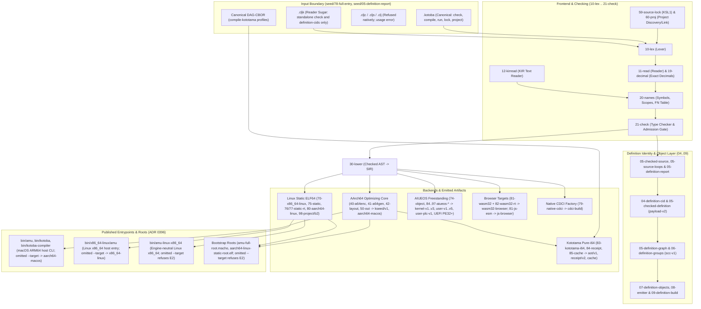

# Amu Compiler Architecture & Primary Measurements

[日本語版 (Japanese)](compiler-architecture.ja.md)

> **Measurement Baseline**
> - **Repository**: `kotoba-lang/amu`
> - **Measured `origin/main` Commit**: `87ec570aff47a0a21b4876fcda4fa9d4e3b934fb` (`87ec570af`)
> - **Measurement Date**: `2026-11-27`
> - **Methodology**: Every count, byte size, SHA-256 digest, scoreboard bound, and status breakdown below was measured directly from the `origin/main` checkout at `87ec570af` using the reproducible relative-path commands documented in each section. Historical performance figures in Section 5 are read directly from repository records and kept strictly separate from current compiler qualification.

---

## 1. Pipeline & Layer Architecture

Amu is the native, self-hosted compiler for Kotoba's Lisp machine in development. Its complete product image is assembled in unity order from the 61 modules listed in [`seed/FULL-MANIFEST`](../seed/FULL-MANIFEST), extending the 18-module adopted compiler core ([`seed/MANIFEST`](../seed/MANIFEST), [ADR 0370](adr/0370-embench-measured-compiler-core.md)) with definition identity, loaderless Linux emitters and static runtimes, freestanding AIUEOS kernel/user/boot routes, browser Wasm32 and restricted JS ESM emitters, Kototama pure-i64 AOT/receipt/cache profiles, and native CDCI packaging.

### Input & Reader-Sugar Boundary

Per [`AGENTS.md`](../AGENTS.md) and verified in [`seed/78-full-entry.kotoba`](../seed/78-full-entry.kotoba) and [`seed/05-definition-report.kotoba`](../seed/05-definition-report.kotoba):

- **Canonical source (`.kotoba`)**: Required for all `compile`, `run`, `--source-lock`, and multi-module project routes.
- **Reader sugar (`.cljk`)**: Accepted natively only on two standalone frontend inspection routes through the same frontend (`dsr-source-input?` / `full-source-ok?`):
  - `check FILE.cljk` (single-file invocation with `argc == 2`, no lock/project flags)
  - `definition-cids FILE.cljk [--groups]` (ADR 0300 identity report)
  - `.edn` has no native compiler entrypoint yet.
- **Refused native inputs (`.cljc`, `.cljs`, `.clj`)**: Refused as usage errors by the native compiler. They remain strictly outside the native build and runtime closure (usable only as local reference oracles or separate hosted CI tooling).

### End-to-End Compiler & Runtime Dataflow



### Verified CLI Commands, Targets, and Published Entrypoints (`ADR 0396`)

Directly verified in [`seed/78-full-entry.kotoba`](../seed/78-full-entry.kotoba), [`native-product.json`](../native-product.json), [`seed/bootstrap/aarch64-macos/cli.json`](../seed/bootstrap/aarch64-macos/cli.json), and [`seed/bootstrap/aarch64-macos/root.json`](../seed/bootstrap/aarch64-macos/root.json):

- **Explicit `--target` values dispatched by `seed/78-full-entry.kotoba`**:
  - Core AArch64: `aarch64-macos` (via `90-drv`)
  - Loaderless Linux ELF64: `x86_64-linux` (formats: default/`static`, `host-entry`, `kx64-runner`, `launcher`, `b2`; `--format platform-linked` is explicitly refused `E2`), `aarch64-linux`
  - Freestanding AIUEOS: `x86_64-aiueos-kernel-v1`, `x86_64-aiueos-kernel-v2`, `x86_64-aiueos-kernel-v3`, `x86_64-aiueos-user-v1`, `x86_64-aiueos-user-v2`, `x86_64-aiueos-user-v3`, `x86_64-aiueos-user-v4`, `x86_64-aiueos-user-v5`, `x86_64-aiueos-user-plc-v1`
  - Browser: `wasm32-browser`, `js-browser`
- **Additional top-level commands in `seed/78-full-entry.kotoba` and `seed/90-drv.kotoba`**:
  - `check`, `compile`, `extract-native`, `compile-kir`, `link`, `modules`
  - `definition-cids <file.kotoba|file.cljk> [--groups]`
  - `compile-kototama` (`kototama.pure-i64-aot/v1` and `kototama.pure-i64-receipt/v2`), `compile-kototama-cache`, `kototama-cache-host-build`
  - `cdci-build`, `bench-build`, `package-aiueos-boot`, `package-aiueos-user-payload`

| Entrypoint / Root Path | Aliases | Format & Size (bytes) | Omitted `--target` Behavior (ADR 0396) |
| --- | --- | --- | --- |
| `bin/amu` → `seed/bootstrap/aarch64-macos/amu-cli.macho` | `bin/kotoba`, `bin/kotoba-compiler` | Mach-O ARM64 (`2,907,488`) | Compiles/runs for `aarch64-macos` (bounded host CLI; explicit `--target` is a usage error; invokes `amu-full-root.macho` `3,925,280` B and `kotoba-packager-root.macho` `182,432` B) |
| `bin/x86_64-linux/amu` | `bin/x86_64-linux/kotoba`, `bin/x86_64-linux/kotoba-compiler` | Loaderless static ELF64 (`10,695,168`) | Rewrites `compile SRC ...` without `--target` to `--target x86_64-linux` (`--format host-entry`; explicit `--target` matches engine-neutral compiler; `nativeQualified: false` in `native-product.json`) |
| `bin/amu-linux-x86_64` | `bin/kotoba-linux-x86_64`, `bin/kotoba-compiler-linux-x86_64` | Loaderless static ELF64 (`10,691,072`) | Engine-neutral compiler; refuses omitted `--target` with `E2` |
| `seed/bootstrap/aarch64-macos/amu-full-root.macho` | — | Mach-O ARM64 (`3,925,280`) | Engine-neutral root; refuses omitted `--target` with `E2` |
| `seed/bootstrap/aarch64-linux-static-root.elf` | — | Loaderless static ELF64 (`4,186,624`) | Engine-neutral root; refuses omitted `--target` with `E2` (no public Linux ARM64 product entry) |

Reproducible entrypoint check:
```sh
ls -la bin/ bin/x86_64-linux/ seed/bootstrap/aarch64-macos/*.macho seed/bootstrap/aarch64-linux-static-root.elf
```

---

## 2. Module & Code-Scale Inventory (`seed/FULL-MANIFEST` + Surrounding Layers)

### Reproducible Measurement Definition

- **Line count (LOC)**: Physical lines per file (`text.count("\n") + (0 if text.endswith("\n") or not text else 1)`).
- **Top-level definition count (`defs`)**: Line-anchored regex `^\((?:defn-?|def)\s+([^\s\(\)\[\]]+)` (counts every top-level `defn`, `defn-`, and `def` at column 0; includes embedded runtime `defn-` lines inside string literals in `76-x86_64-static-rt.kotoba` and `77-aarch64-static-rt.kotoba` that start at column 0).
- **Unity byte size**: Concatenating all 61 modules in `seed/FULL-MANIFEST` order, each followed by one `\n` (`b"\n".join(bytes_per_file) + b"\n"`), yields **4,102,044 bytes** (`4,101,983` raw bytes + `61` separator/trailing newlines), matching SHA-256 `90f489962f63d73e8595b84eb39afe73047d787df078d6325a8521f5b10f1981` recorded in [`docs/qualification/qualifier-native-20261108.json`](qualification/qualifier-native-20261108.json) and [`native-product.json`](../native-product.json).

> **Note on module count reconciliation**: `origin/main` `seed/FULL-MANIFEST` contains **61 modules** (consistent with `sourceModuleCount: 61` in `native-product.json` and `docs/qualification/qualifier-native-20261108.json`). Earlier prose in `README.md` (`49-module`) is updated in this documentation pass; older prose references in `AGENTS.md` (`47`/`48` modules) reflect pre-expansion snapshots.

### `seed/FULL-MANIFEST` Inventory by Responsibility Layer (61 Modules)

| Responsibility Layer | Modules | LOC | Definitions | Raw Bytes | Share of Bytes |
| --- | ---: | ---: | ---: | ---: | ---: |
| **1. Adopted Core** (`00-ns-static`..`03`, `10`..`12`, `19`..`21`, `30`, `40`..`42`, `50`, `59`..`60`, `90`) | 18 | 44,831 | 5,965 | 2,991,042 | 72.92% |
| — *1a. Static NS, Memory, IO & SHA-256* (`00-ns-static`, `01-mem`, `02-io`, `03-source-sha256`) | *4* | *1,264* | *804* | *46,058* | *1.12%* |
| — *1b. Frontend: Lex, Read, KIR Read, Decimal, Names, Check* (`10`, `11`, `12`, `19`, `20`, `21`) | *6* | *12,855* | *1,595* | *768,157* | *18.73%* |
| — *1c. Lowering to SIR* (`30-lower`) | *1* | *1,691* | *201* | *93,717* | *2.28%* |
| — *1d. AArch64 Backend, Layout & `kseed/v1` Output* (`40`, `41`, `42`, `50`) | *4* | *26,283* | *3,005* | *1,914,274* | *46.67%* |
| — *1e. Source Lock, Project Linker & Core Driver* (`59`, `60`, `90`) | *3* | *2,738* | *360* | *168,836* | *4.12%* |
| **2. Definition Identity, Checked-Source Bridge & Object Build** (`04`, `05-*`, `06`, `07`, `08`, `09`) | 10 | 2,657 | 319 | 176,533 | 4.30% |
| **3. Native Linux Emitters, Runtimes, Project & B2** (`70`..`73`, `75`..`78-platform`, `80`, `98-project`, `98-b2`) | 11 | 7,552 | 1,117 | 487,594 | 11.89% |
| **4. AIUEOS Freestanding Kernel, User, ValueRuntime & UEFI Boot** (`74`, `84`..`89`, `91`..`97`) | 14 | 4,443 | 592 | 299,585 | 7.30% |
| **5. Browser Targets: Wasm32 & Restricted JS ESM** (`81-wasm32`, `82-wasm32-rt`, `81-js-esm`) | 3 | 1,263 | 222 | 86,616 | 2.11% |
| **6. Kototama Pure-i64 AOT, Receipt & Cache Profiles** (`83`, `84-receipt`, `85-cache`) | 3 | 615 | 86 | 46,387 | 1.13% |
| **7. Native CDCI & Combined Entrypoint** (`79-native-cdci`, `78-full-entry`) | 2 | 199 | 18 | 14,226 | 0.35% |
| **Total (`seed/FULL-MANIFEST`)** | **61** | **61,560** | **8,319** | **4,101,983** | **100.00%** |
| **Concatenated Unity (`file + "\n"` per module)** | **61** | — | — | **4,102,044** | — |

### Surrounding Layers Outside `seed/FULL-MANIFEST`

Measured across Git-tracked files (`git ls-files`) at `87ec570af`:

| Layer / Scope | Tracked Files | LOC | Definitions | Raw Bytes | Composition Notes |
| --- | ---: | ---: | ---: | ---: | --- |
| `seed/macos-*.kotoba` | 68 | 11,004 | 1,053 | 600,934 | Public macOS ARM64 host CLI (`macos-cli.kotoba`, `macos-cli-api.kotoba`), Mach-O runtime packagers (`macos-fs2-runtime-packager.kotoba`, etc.), and macOS smoke/refusal harnesses |
| Other top-level `seed/*.kotoba` (outside `FULL-MANIFEST` & `macos-*`) | 9 | — | — | 27,081 | Core non-static namespace (`00-ns.kotoba`), `99-entry.kotoba`, `gen-static-ns.kotoba`, alternate entry/packager modules (`72`, `73`, `76-none`, `99-definition-cids`, `linux-curl-sigxfsz`, `x86_64-kx64-runner`) |
| `scripts/seed/**` (tracked) | 299 (295 top-level) | 44,662 | — | 2,864,118 | 181 `.cljc`, 110 `.py`, 2 `.md`, 2 `.kotoba`, 1 `.c`, 1 `.comp`, 1 `.sh`, 1 tracked `.pyc` |

### Code-Sharing & Consolidation Opportunities

Direct structural comparison of the largest and most closely related compiler modules on `origin/main`:

| Comparison / Module | Exact Scale (LOC / Bytes / Defs) | Observed Overlap & Consolidation Opportunity |
| --- | --- | --- |
| `seed/76-x86_64-static-rt.kotoba` vs `seed/77-aarch64-static-rt.kotoba` | `76`: 2,753 LOC / 177,844 B / 405 defs<br>`77`: 2,578 LOC / 166,351 B / 368 defs | **2,400 identical lines** (`SequenceMatcher` ratio `0.9004`; **87.2%** of `76`, **93.1%** of `77`) and **357 identical definition names**. Module `77`'s header notes it was generated from one template with `76`, differing primarily in syscall numbers, `open`/`alarm`, `O_*` flags, seccomp architecture/allow-lists, and two x86_64-only sections (`--format host-entry` and `--format platform-linked`). By contrast, `seed/82-wasm32-rt.kotoba` (176 LOC / 11,072 B / 44 defs) already slices four shared sections directly from `77` (`xa-rt-core`) by section markers at compile time (refusing `E7106` if missing). Unifying the shared body of `76` and `77` into one parameterized source template/slicer would eliminate ~2,400 duplicated lines and reclaim ~150+ KiB from the compiler's `LITB` literal budget. |
| `seed/70-x86_64-linux.kotoba` vs `seed/80-aarch64-linux.kotoba` | `70`: 507 LOC / 32,630 B / 81 defs<br>`80`: 446 LOC / 28,815 B / 71 defs | Both are plain stack-machine emitters over the same runtime-profile SIR (`71-x86_64-runtime.kotoba`). Exact line overlap is low (13 lines, ratio `0.0273`) because instruction encodings and ELF machine headers differ (`EM_X86_64` vs `EM_AARCH64`), yet `80` directly reuses `70`'s frame/helper functions (`xg-frame`, `xg-local`, `xg-temp`, `xg-bytes`, `xg-code-byte`) and mirrors **15 parallel function suffixes** (`bin-op`, `build`, `cmp`, `code`, `command`, `elf`, `elf-header`, `fix`, `fix-target`, `fn`, `frame`, `fuel`, `one`, `params`, `un`). Notably, `80-aarch64-linux` is intentionally independent of `41-a64gen`, so AArch64 currently carries two separate SIR emitters in `FULL-MANIFEST`. |
| `seed/41-a64gen.kotoba` | 25,225 LOC / 1,861,233 B / 2,790 defs | Accounts for **41.0% of all LOC**, **45.4% of all raw bytes**, and **33.5% of all top-level definitions** in `seed/FULL-MANIFEST`. Combines R2 register allocation, FP register homes (`S1`), size-budgeted T2 optimizing passes (`t2-max-sir`), inline AArch64 encoders beyond `40-a64enc.kotoba` (181 LOC / 13,003 B / 92 defs), and certified AArch64 codegen patterns in a single file. |

### Fixed-Point Binary Scale & Publication Scope Caveats

From [`docs/qualification/qualifier-native-20261108.json`](qualification/qualifier-native-20261108.json) (schema `amu.native-qualification-record.v1`, CI run `42452363274`, `sourceRevision: 09babcce5040a8b3f0a7865f1641781d8363a112`) and [`native-product.json`](../native-product.json):

| Metric / Qualification Flag | Verified Value |
| --- | --- |
| `sourceModuleCount` / `verifiedObservations.sourceFilesAndManifest` | `61` |
| `sourceUnity.bytes` / `sha256` | `4,102,044` bytes / `90f489962f63d73e8595b84eb39afe73047d787df078d6325a8521f5b10f1981` |
| `verifiedObservations.sourceUnityMatchesCurrentTree` | `true` (confirmed byte-identical on `origin/main` `87ec570af`) |
| `compilerImage` (`x86_64` static ELF64, `bin/amu-linux-x86_64`) | `10,691,072` bytes / `237b61cce51d442aed83ba5006de2828424ed55ef201a622054444179722c812` |
| `x86NativeGenerations` (F1 = F2 = F3) | 3 identical generations (`ET_EXEC/EM_X86_64`, `interpreter: false`, `dynamic: false`) |
| `armRoot` (`seed/bootstrap/aarch64-linux-static-root.elf`) | `4,186,624` bytes / `8e89528f3ca10704ecabcac2a54b0547325e427c7ed70b4ffca913088e9fc24d` |
| `ci.workflowCompletionVerified` / `ci.conclusion` | `true` / `"success"` |
| `verifiedObservations.noCCompilerOrLoader` | `true` |
| `verifiedObservations.noJVMLoaderFallback` | `true` |
| `verifiedObservations.nativeCDCIExecutionQualified` | **`false`** |
| Receipt statuses (`complete`, `public`, `oneCompiler`, `bootstrap`) | `PASS_COMPLETE_NATIVE_X86_COMPILER_BUILD`, `PASS_PUBLIC_NATIVE_PRODUCT`, `PASS_COMBINED_COMPILER`, `PASS_LOADERLESS_SELFHOST_BOOTSTRAP` |
| Additional product flags in `native-product.json` | `nativePinnedCheckAndCompile: true`, `legacyRuntimeFallback: false`, `currentCompilerLinkVerified: true`, `controllerQualified: false`, `broaderPublicCompatibilityQualified: false`, `hostEntry.nativeQualified: false` |

**Explicit publication scope caveat** (verbatim boundary from `qualifier-native-20261108.json`): This record qualifies native compiler reproduction (`x86_64` F1=F2=F3 matching the pinned public image) and public product/link verification. It is **not** controller execution qualification, **not** broader public compatibility, and **not** independent clean-host qualification; `nativeCDCIExecutionQualified` is `false`.

Reproducible measurement commands:
```sh
python3 -c '
import re, hashlib
with open("seed/FULL-MANIFEST") as f:
    mods = [l.strip() for l in f if l.strip() and not l.strip().startswith("#")]
def_re = re.compile(r"^\((?:defn-?|def)\s+([^\s\(\)\[\]]+)", re.M)
loc = raw = defs = 0
for m in mods:
    b = open(m, "rb").read(); t = b.decode("utf-8")
    loc += t.count("\n") + (0 if t.endswith("\n") or not t else 1)
    raw += len(b); defs += len(def_re.findall(t))
unity = b"\n".join(open(m, "rb").read() for m in mods) + b"\n"
print(f"modules={len(mods)} loc={loc} defs={defs} raw={raw} unity={len(unity)} sha256={hashlib.sha256(unity).hexdigest()}")
'

python3 -c '
import subprocess, re
def_re = re.compile(r"^\((?:defn-?|def)\s+([^\s\(\)\[\]]+)", re.M)
for label, pat in [("macos-*", "seed/macos-*.kotoba"), ("scripts/seed", "scripts/seed")]:
    files = subprocess.check_output(["git", "ls-files", pat], text=True).splitlines()
    loc = raw = defs = 0
    for f in files:
        b = open(f, "rb").read(); t = b.decode("utf-8", errors="replace")
        loc += t.count("\n") + (0 if t.endswith("\n") or not t else 1)
        raw += len(b); defs += len(def_re.findall(t))
    print(f"{label}: files={len(files)} loc={loc} bytes={raw} defs={defs}")
'
```

---

## 3. Target & OS Coverage Scoreboard (`ADR 0410`)

Source files: [`docs/qualification/target-coverage/table.json`](qualification/target-coverage/table.json), [`docs/qualification/target-coverage/snapshots/20261106/report.json`](qualification/target-coverage/snapshots/20261106/report.json), [`docs/qualification/target-coverage/snapshots/20261106/provenance.json`](qualification/target-coverage/snapshots/20261106/provenance.json), and [`docs/adr/0410-what-99-percent-coverage-means.md`](adr/0410-what-99-percent-coverage-means.md).

### Local Verification Run (`Basilisp 0.5.1`)

The scoreboard verifier ran locally on `2026-11-27`:

```sh
basilisp run scripts/coverage/scoreboard.cljc -- verify
# Exit 0 -> 20261106: report.json matches, lower 2.15%

basilisp run scripts/coverage/scoreboard.cljc -- report \
  --snapshot docs/qualification/target-coverage/snapshots/20261106 --as-of 2026-11-27
# Exit 0 -> L1 coverage on 2026-11-27, head f6c6ea215: 2.15% lower, 8.09% upper, of 99.18% listed; threshold 99.00%

basilisp run scripts/coverage/scoreboard.cljc -- report \
  --snapshot docs/qualification/target-coverage/snapshots/20261106 --as-of 2026-12-07
# Exit 0 -> L1 coverage on 2026-12-07, head f6c6ea215: 0.00% lower, 0.00% upper, of 99.18% listed; threshold 99.00%
```

### Denominator & L1 Coverage Summary (Snapshot `20261106`, Head `f6c6ea215a8c51383c5ebac0b39879cef780eafb`)

- **Denominator**: StatCounter global OS market share (all platforms, worldwide), period `2026-10`, retrieved `2026-11-06`, total listed **`99.18%`** (`9,918` basis points).
- **Threshold**: **`99.00%`** (`9,900` bp) at **L1**, judged strictly on the **lower bound**.
- **Measured L1 Lower Bound**: **`2.15%`** (`215` bp; Linux only, because both listed Linux ISAs pass).
- **Measured L1 Upper Bound**: **`8.09%`** (`809` bp; Linux `2.15%` + macOS `5.94%`, because `aarch64-macos` passes while `x86_64-macos` is missing and the ISA split is unmeasured).
- **Threshold & Gate Flags**: `meetsThreshold: false`, `gateVerdict: false` (this report is informational, not a native controller gate).
- **30-Day Expiry Rule**: `maxEvidenceAgeDays: 30` in `table.json`; `scripts/coverage/scoreboard.cljc` marks evidence stale when `age > 30` days from the oldest CI run (`2026-11-06`). Snapshot `20261106` therefore expires on **`2026-12-07`** (day 31), when both lower and upper bounds fall to **`0.00%`**.

| OS Slice | Global Share | Basis Points | Listed Targets | Passing at L1 | L1 Lower | L1 Upper | ISA Split Measured |
| --- | ---: | ---: | --- | --- | ---: | ---: | --- |
| Android | 44.56% | 4,456 | `aarch64-android`, `armv7-android`, `x86_64-android` | — | 0.00% | 0.00% | `false` |
| Windows | 29.08% | 2,908 | `x86_64-windows`, `aarch64-windows` | — | 0.00% | 0.00% | `false` |
| iOS | 17.45% | 1,745 | `aarch64-ios` | — | 0.00% | 0.00% | `false` |
| macOS | 5.94% *(OS X 3.74 + macOS 2.20)* | 594 | `aarch64-macos`, `x86_64-macos` | `aarch64-macos` | 0.00% | 5.94% | `false` |
| Linux | 2.15% | 215 | `x86_64-linux`, `aarch64-linux` | `x86_64-linux`, `aarch64-linux` | 2.15% | 2.15% | `false` |
| **Total** | **99.18%** | **9,918** | **10 targets** | **3 targets** | **2.15%** | **8.09%** | — |

### Per-Target L1 / L2 / L3 Status & Caveats

**Development hosts at L3** (requiring L1, L2, and L3 all `pass` per `developmentHostsAtL3`): **`x86_64-linux`** (`true`) and **`aarch64-macos`** (`true`). The other four listed development hosts (`aarch64-linux`, `x86_64-macos`, `x86_64-windows`, `aarch64-windows`) are `false`.

| Target | Host | L1 (Target Run) | L2 (Public Host CLI) | L3 (Native Selfhost) | Recorded Caveats / Blocking Notes |
| --- | --- | --- | --- | --- | --- |
| `x86_64-linux` | Linux x86_64 | `pass` | `pass` | `pass` | L3 caveat: `complete-x86.json` has `nativeCDCIExecutionQualified: false` |
| `aarch64-linux` | Linux aarch64 | `pass` | `missing` | `pass` | No public Linux ARM64 product entry; therefore `developmentHostsAtL3["aarch64-linux"]` is `false` |
| `aarch64-macos` | Darwin arm64 | `pass` | `pass` | `pass` | L1 & L2 caveats: `public-macos-product.json` has `fullRuntimeQualified: false` and `independentUserQualified: false`; CI runner is virtualized (`physicalHardware: false`) |
| `x86_64-macos` | Darwin x86_64 | `missing` | `missing` | `missing` | No native x86_64 macOS evidence; Rosetta emulation does not count as native evidence |
| `x86_64-windows` | Windows AMD64 | `missing` | `missing` | `missing` | No native Windows x86_64 L1/L2/L3 evidence |
| `aarch64-windows` | Windows ARM64 | `missing` | `missing` | `missing` | No native Windows ARM64 L1/L2/L3 evidence |
| `aarch64-android` | Android aarch64 | `missing` | `missing` | `missing` | L1 missing (physical device required); L2/L3 open (Android API 29+ forbids `execve` from app home directory) |
| `armv7-android` | Android armv7l | `missing` | `missing` | `missing` | Not a compiler target; Android ABI pageview share is `unknown` (unmeasured on `origin/main`, inclusion open per ADR 0410) |
| `x86_64-android` | Android x86_64 | `missing` | `missing` | `missing` | Not a compiler target; Android ABI pageview share is `unknown` (unmeasured on `origin/main`, inclusion open per ADR 0410) |
| `aarch64-ios` | iOS arm64 | `missing` | `prohibited` | `prohibited` | L1 missing (physical device required); L2/L3 prohibited for App Store apps by Apple App Review Guideline 2.5.2 |

---

## 4. Language Ladder & Syntax Surface Summary

### Language Ladder (`docs/language-ladder.edn`, ADR 0353)

Per [`docs/language-ladder.edn`](language-ladder.edn), a floor is **closed** only when its named gate (`(deftest <gate>`) exists in its repository (default `kotoba-lang/amu`) on `origin/main`. Direct measurement on `87ec570af`:

| Status Category | Count | Details |
| --- | ---: | --- |
| **Closed** (`(deftest <gate>` present in `kotoba-lang/amu`) | **47** | Includes `:export-from-publicity` through `:options-map-argument`, `:vector-parameter`, `:record-list-sequence`, `:record-field-update` through `:row-tuple-element-argument`, `:record-list-field-literal`, and the 4 selfhost foundation floors (`:document-type-predicates`, `:expression-absence`, `:native-abort`, `:native-document`) |
| **Needs Human Design Decision** (`:needs-a-human`) | **5** | `:export-signatures`, `:open-event-row`, `:destructured-key-fallback`, `:input-log-events`, `:absent-field-from-expression` |
| **Blocked in `kotoba-lang/amu`** (`:blocked-by`, gate absent) | **3** | `:browser-text-edit`, `:browser-input`, `:browser-surface` |
| **Blocked in External Repo** (`kotoba-lang/browser`) | **1** | `:hosted-engine-switch` (`:blocked-by [:browser-text-edit :browser-input :browser-surface]`) |
| **Open & Unblocked** | **0** | — |
| **Total Floors** | **56** | — |

Reproducible command:
```sh
python3 -c '
import re, os
text = "\n".join(re.sub(r";;.*$", "", l) for l in open("docs/language-ladder.edn").read().splitlines())
body = re.search(r":floors\s*\[(.*)\]\s*\}\s*$", text, re.S).group(1)
floors, depth, start, in_str, esc = [], 0, None, False, False
for i, ch in enumerate(body):
    if in_str:
        esc = (not esc and ch == "\\") if esc or ch == "\\" else False
        if not esc and ch == "\"": in_str = False
        continue
    if ch == "\"": in_str = True
    elif ch == "{":
        if depth == 0: start = i
        depth += 1
    elif ch == "}":
        depth -= 1
        if depth == 0: floors.append(body[start:i+1])
deftests = set()
for root, dirs, files in os.walk("."):
    if ".git" in dirs: dirs.remove(".git")
    for fn in files:
        if fn.endswith((".cljc", ".cljk", ".clj", ".kotoba")):
            deftests.update(re.findall(r"\(deftest\s+([^\s\(\)]+)", open(os.path.join(root, fn), errors="ignore").read()))
counts = {"closed": 0, "needs_human": 0, "blocked_amu": 0, "blocked_ext": 0, "open": 0}
for fl in floors:
    gate = (re.search(r":gate\s+\"([^\"]+)\"", fl) or [None, None])[1]
    repo = (re.search(r":repo\s+\"([^\"]+)\"", fl) or [None, "kotoba-lang/amu"])[1]
    if gate and repo == "kotoba-lang/amu" and gate in deftests: counts["closed"] += 1
    elif ":needs-a-human" in fl: counts["needs_human"] += 1
    elif repo != "kotoba-lang/amu": counts["blocked_ext"] += 1
    elif ":blocked-by" in fl: counts["blocked_amu"] += 1
    else: counts["open"] += 1
print("total=", len(floors), counts)
'
```

### Syntax Surface Authority (`kotoba-lang/kotoba-lang`)

The canonical language surface registry lives in the public [`kotoba-lang/kotoba-lang`](https://github.com/kotoba-lang/kotoba-lang) repository at [`lang/surface-status.edn`](https://github.com/kotoba-lang/kotoba-lang/blob/main/lang/surface-status.edn) (verified read-only on `2026-11-27` via `gh api repos/kotoba-lang/kotoba-lang/contents/lang/surface-status.edn`: blob SHA `bc75330c2ec5d3145c6d579917046b59b087c769`, `229,774` bytes, `2,971` lines, profile version `6`, `as-of: "2026-08-30"`). Its recorded `:disposition` breakdown across 64 classified entries is:

- `:implemented-partial`: **40**
- `:intentional-security-constraint`: **10**
- `:intentional-semantic-simplification`: **5**
- `:implemented`: **5**
- `:not-yet-implemented`: **4**

> **Reporting Boundary**: Never summarize language or syntax coverage as `"99%"`. Always report strictly definition- and measurement-based counts (such as the 47/56 closed floors in `docs/language-ladder.edn` and the disposition breakdown in `lang/surface-status.edn`). The `99%` threshold in ADR 0410 applies exclusively to the L1 OS/ISA target-coverage scoreboard denominator in Section 3.

---

## 5. Execution Performance Measurement Summary (Strictly Historical / Exploratory)

> [!WARNING]
> **Historical & Exploratory Measurements Only — Not Official Embench Scores or Current CLI Performance**
>
> Every figure in this section is a **historical, exploratory measurement** of a specific past compiler snapshot on translated Kotoba ports. None of these figures is an official or certified Embench score, a universal speed ranking, or a measurement of the current published `bin/amu` or `bin/x86_64-linux/amu` CLI. In particular, the `2026-10-15` M4 observation (`0.80×` / `m93` `0.7999×`) used one sample per workload on a specific snapshot with audited algorithm substitutions and ARMv8 SHA-256 hardware instructions on the Kotoba side only. Keep the full boundary and audit attached whenever citing these numbers:
> **[https://kotoba-lang.org/blog/embench-c-parity-20261015/](https://kotoba-lang.org/blog/embench-c-parity-20261015/)**

### Historical Benchmark Snapshots Verified in Repository Sources

| Record Source | Snapshot / Compiler | Workload Scope & Method | Measured Result (Kotoba / C Time Ratio; `< 1` = Faster) | Key Caveats & Audit Notes |
| --- | --- | --- | --- | --- |
| [`bench/embench/REPORT-20260929.md`](../bench/embench/REPORT-20260929.md) | Standalone ARM64 compiler (`59e30812...`), Apple M4, macOS 26.3.1 | 19 named Embench-IoT ports (**9 full** single-iteration translations + **10 adapted** algorithmic probes); 5 medians per workload | Check: `12.69–49.94 ms`; Compile: `44.72–657.93 ms`; Execute: `4 µs–1.894 s`; Raw code: `448–55,960 B` (all 19 correctness exports returned `1`) | Not an official Embench score; no C speed ratio reported; raw code bytes include branch-offset prefix |
| [`seed/README.md`](../seed/README.md) | Round 83 (pre-lookup historical snapshot; later Round 88 & Round 96 checkpoints also recorded) | 19 translated workloads via upstream Embench speed driver and formula | **Round 83**: `2.936×` (`2.936403450579294`) *(later Round 88: `2.946×`; Round 96: `2.874×`)* | C was faster overall; exploratory translated-port baseline prior to later M104 work |
| [`bench/embench/reproduce-20261015/README.md`](../bench/embench/reproduce-20261015/README.md) | **`m93`** (`be7f0ce3`, 2026-10-15), Apple M4 Mac mini vs Apple clang 17.0.0 `-O2` | 19 translated workloads, 1 accepted sample/workload, ≥ 70% CPU idle gate, 0.5 s floor | **`0.7999×`** (`0.7998826447941968` offline recomputed; superseded) | **Superseded**: kernel audit found substitution kernels (`huffbench` `st`/`hd`/`eb`, `qrduino` `qa`/`bp`/`mr`, `tarfind` `lcg`, `ud` col-0 `init`, `picojpeg` NEON IDCT) and ARMv8 SHA-256 instructions in `nettle-sha256` on Kotoba only |
| [`docs/adr/0370-embench-measured-compiler-core.md`](adr/0370-embench-measured-compiler-core.md) & [`bench/embench/reproduce-20261015/README.md`](../bench/embench/reproduce-20261015/README.md) | **`M104`** (`a9edc1f0`, same-algorithm policy, scalar SHA-256), Apple M4 vs Apple clang `-O2` | 19 translated workloads, same-algorithm-only fixed-point compiler, scalar SHA-256, upstream driver | **`0.8213×`** (`0.821298642657085`; offline audit `0.8212986426570839`). Separate 2026-10-16 cycle on another Apple M4 Mac mini (clang 21.0.0): `0.7878×` (`0.7877703356`). 2026-10-16 Apple M1 Max attempt: rejected (`0/19` accepted, CPU idle < 70%) | Host-specific cycles are not averaged. Adopted core lineage is **`M105`** (`6103f5cf`); no official timing round is attributed to M105 or the current 61-module `FULL-MANIFEST` build |

### `REPORT-20260929.md` Per-Workload Breakdown (19 Workloads: 9 Full, 10 Adapted)

| Workload | Fidelity | Check (ms) | Compile (ms) | Execute | Raw Code Bytes |
| --- | --- | ---: | ---: | ---: | ---: |
| `aha-mont64` | full | 22.60 | 104.46 | 7 µs | 3,240 |
| `crc32` | full | 25.15 | 388.86 | 29 µs | 17,796 |
| `depthconv` | full | 19.03 | 300.17 | 29 µs | 4,996 |
| `edn` | adapted | 14.38 | 83.64 | 45 µs | 1,940 |
| `huffbench` | adapted | 13.87 | 48.44 | 5 µs | 564 |
| `matmult-int` | full | 37.18 | 657.93 | 32 µs | 29,864 |
| `md5sum` | full | 24.82 | 161.71 | 19 µs | 8,604 |
| `nettle-aes` | adapted | 17.26 | 84.65 | 8 µs | 1,684 |
| `nettle-sha256` | full | 32.44 | 199.83 | 12 µs | 9,948 |
| `nsichneu` | adapted | 15.09 | 57.62 | 10 µs | 524 |
| `picojpeg` | adapted | 13.96 | 50.79 | 5 µs | 652 |
| `qrduino` | adapted | 13.74 | 67.95 | 4 µs | 1,612 |
| `sglib-combined` | adapted | 16.94 | 61.68 | 13 µs | 1,600 |
| `slre` | adapted | 15.26 | 59.88 | 4 µs | 1,336 |
| `statemate` | adapted | 12.69 | 44.72 | 5 µs | 448 |
| `tarfind` | full | 20.20 | 78.32 | 20 µs | 1,800 |
| `ud` | full | 39.56 | 192.48 | 9 µs | 6,596 |
| `wikisort` | adapted | 25.80 | 120.08 | 482 µs | 3,312 |
| `xgboost` | full | 49.94 | 202.18 | 1.894 s | 55,960 |

Offline recomputation command for the archived historical `m93` package (Python ≥ 3.9, no compiler execution):
```sh
python3 bench/embench/reproduce-20261015/a_offline.py --round rounds/m93-20261015.json
```

Audit & methodology article: **[https://kotoba-lang.org/blog/embench-c-parity-20261015/](https://kotoba-lang.org/blog/embench-c-parity-20261015/)**
