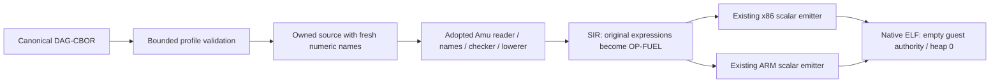

# Bounded Kototama pure i64 AOT

JUN-369 implements the first native engine profile. Canonical Kototama bytes
are validated, translated into compiler-owned source, checked/lowered by the
existing adopted Amu core, and emitted as a loaderless Linux executable.
There is no evaluator, hosted compiler, C compiler/loader or dynamic import.



## Command

The current native compiler supports:

```sh
KEXE_ALLOW=35,37,38,39 KEXE_CAP_RESOURCES_35="$PWD" bin/amu compile-kototama program.cbor --target x86_64-linux --output answer.elf --fuel 100 --profile kototama.pure-i64-aot/v1
chmod +x answer.elf
./answer.elf | od -An -td8
```

`aarch64-linux` is the other explicit target. No target, profile, budget,
permission or argument is inferred from the environment. The output path
must not exist. Unknown/extra options and unsupported profiles are refused.
The command consumes binary DAG-CBOR, not EDN KIR or a signed kexe.

## Closed profile

The envelope is `["kototama.vm/program", 1, program]`. The program map must
contain exactly `entry`, `exports`, `methods`, `value-profile`. The value
profile must be `kotoba.i64-wrap/v1`. Each method contains exactly `params`,
`param-types`, `result`, `effects`, `body`. Every parameter/result is `i64`
and every method's effects are empty, including unreachable methods.
Imports and all unknown fields are refused, even when empty.

| Resource | Admission limit |
| --- | --- |
| Input | 1–65536 bytes, no trailing bytes |
| Decoder | fewer than 4096 actual nodes (4096 slots include null), depth at most 64 |
| Encoding | definite lengths, shortest unsigned/length encodings, strictly ordered unique text map keys; no tags, floats or byte strings |
| Text | printable ASCII, at most 128 bytes; method/variable names 1–64 bytes |
| Methods | 1–32, acyclic direct call graph, at most 5 parameters each |
| Invocation | declared, exported, zero-argument entry only; all methods validated |
| Expressions | at most 16 operands/bindings per form; at most 64 lexical bindings |
| Native frame | existing scalar emitter's 4096-byte frame limit |
| Stack | conservative sum of all function frames plus return/frame links, at most 262144 bytes |
| Heap / arena | zero guest allocations; collections/data values refused |
| Fuel | explicit positive integer, at most 9007199254740991; one unit per original expression |
| Guest authority | empty; no host slot, capability instruction, external import or indirect call |

Supported tags are `const` (bounded canonical decimal integer), `var`,
sequential `let`, `if`, nonempty `do`, direct `call`, `loop` and tail `recur`,
`arith` (`add/sub/mul/div/quot/mod`) and `compare` (`=/< />/<=/>=`).
Addition/multiplication accept zero operands with identities 0/1;
subtraction needs at least one; division/remainder need exactly two;
comparison needs at least two. Duplicate loop binders and parameters are
refused. Sequential let shadowing is supported. Negative zero literals are
outside this profile. Recursive methods, non-tail recur, runtime arguments,
nil/boolean/text/collection values and effect/state forms remain unsupported.

## Semantics and enforcement

Each original tagged expression places one sealed `kt-charge` marker before
evaluation. All original identifiers are renamed to numeric names before
entering the reader, so artifact text cannot name the marker or an intrinsic.
The normal checker still resolves/types every generated expression.

The existing lowerer annotation interface suppresses ordinary function-entry
and loop-backedge charges. A pass changes only calls to the compiler-owned
marker into the existing `OP-FUEL`. The adopted core files are unchanged.
Generated scaffolding has no canonical charge. Calls share one fuel context;
loop headers charge the body on each iteration and the loop expression once.

Arithmetic wraps modulo 2^64. Quotients truncate toward zero; division by
zero and MIN/-1 trap. Remainder has the dividend's sign and MIN rem -1 = 0.
Operands are evaluated eagerly from left to right before arithmetic or
comparison reduction. Conditions use zero=false. Loop initializers see the
outer environment; recur updates bindings simultaneously. Only the selected
branch evaluates and consumes fuel.

Scalar SIR admission refuses capabilities and runtime/heap operations before
emission. The acyclic method graph and bounded native frames give a finite
stack bound; loops cannot grow it. Code is RX, fuel data RW and the stack NX.
The trusted executable envelope only writes the returned i64 to stdout and
exits. This fixed transport is outside the guest's empty capability set.

## Process protocol and qualification boundary

Success exits 0 with exactly eight little-endian result bytes. The envelope
exits 74 on a returned short/error write. Fuel exhaustion emits no result and
traps (SIGTRAP on ARM, SIGILL on x86); arithmetic traps are SIGTRAP on ARM
and SIGFPE on x86. These are the bounded executable protocol, not full VM
receipts or a general host ABI. Fuel accounting inside an accepted run is
canonical, but typed failure/overspend receipts are not implemented here.

This command does not admit a downloaded executable into a Murakumo node.
A node must not treat compilation, a cache hit or the embedded budget as
authorization. JUN-370 covers broader fuel/resource/failure qualification;
JUN-371 covers Program CID + compiler/profile/target keyed cache and fresh
admission; JUN-372 covers signed host/effects/Cell/receipt integration;
JUN-373 covers heterogeneous nodes and cold/warm performance. No production
route or runtime class changes here. No speedup or full-VM claim is made.

The standalone image embeds its explicit fuel budget. A code cache for node
invocations must separate executable identity from a fresh invocation context;
this process image cannot silently become a budget-independent cached lease.

## Native verification

```sh
python3 scripts/seed/check-kototama-i64.py --compiler /absolute/native/amu --output /new/output/directory
```

Run on a native Linux ARM or x86 kernel. Python serializes fixed literal
vectors, launches the native compiler/guests and transports raw observations.
An Amu-built Kotoba program owns the ordered verdict. A corrupted-observation
control must fail. Golden tests cover results, exact fuel and one-less
budgets, arithmetic traps, infinite loops, eager comparison arguments,
parallel recur, outer-scope loop initializers, source-injection names,
unreachable effects, schema/authority/arity/encoding/depth/size refusals.
The same gate runs in both native CI jobs alongside the existing qualification.
The upstream CLJK evaluator was not executed: its retired Node/JVM hosts are
outside the permitted test closure. These source-derived fixed goldens are
not a whole-VM differential parity result. Broader parity needs a qualified
native oracle or the canonical conformance corpus in JUN-370.

The wire/semantic migration references reviewed on 2026-10-24 are
`kotoba-vm/src/kotoba/vm/kototama/program.cljk` (blob
`65dbbf03d2804820b23fe6b21ade1e7d43cdb5ed`), `interpreter.cljk` (blob
`a11d244f7b3aacc4b4f548317691dd2500babc60`) and `kernel.cljk` (blob
`d27233720ac385a93b2c8e4b1446425c66d34913`); the one-unit `:guest/op` cost is
in `syscall.cljk` (blob `9bb8c37f0d374f57035e5d34d8baf9c65d06338e`).
They are references, never an
executable compiler/test dependency or a JVM/Node fallback.
