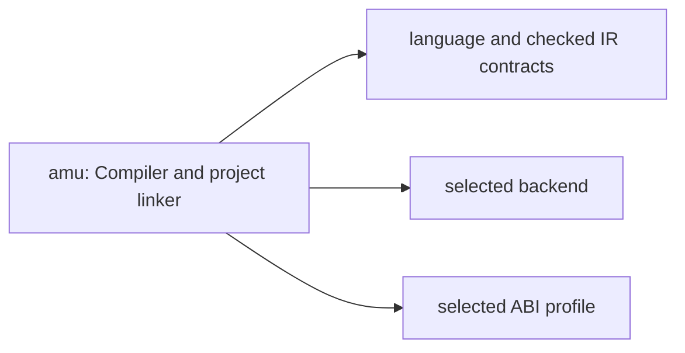

# amu: stack integration

Status: accepted architecture direction, updated 2026-10-15. This document and
[composition metadata](../spec/stack-integration.edn) describe ownership and
future boundaries; they do not change runtime schemas or certify migration.

## Responsibility

Checks target-independent semantics and emits the default Kototama program or an explicitly selected Native, Wasm core, Component, Script or bounded EVM artifact. Project linking belongs here; runtime linking belongs to the host. The default program is a host-independent, content-addressed DAG-CBOR Kototama expression artifact; native ISA and Wasm remain explicit target choices. EVM output is a bounded compiler slice, not a settlement network or proof of full Kototama conformance.

## Contract dependency direction

Native module calls share the linked unit's value representation, context and
budget. Single-clause root exports bind directly to their implementations when
names cannot capture locals; multi-arity/collision wrappers remain. Module
imports do not cross a guest/host ABI. Actual foreign/profile, provider,
authority and independent resource boundaries still do. See the shared
[native execution-domain decision](https://github.com/kotoba-lang/kotoba-lang/blob/main/docs/adr/ADR-native-execution-domains.md).
Removing a forwarding call changes implementation overhead, never refills fuel
or relaxes arena bounds, and does not qualify a selfhost compiler by itself.
Import signatures are checked without constructing dummy result values;
recursive records need no foreign-boundary default value. The signature-only
stubs are removed before code generation.

Arrows are consumer → contract dependency. These are intended entrypoint
boundaries, not whole-repository imports already achieved.

The measured selected-owner production dependencies at base `4eb6c3f767abed02faf6a7e7954d28ef1fe09666`
are `abi`, `kotoba-core-contracts`.
This selection excludes other libraries; alias-only build/test imports remain
separate in the [full observation](https://github.com/kotoba-lang/kotoba-lang/blob/main/lang/stack-dependency-observation.edn).

## Shared architecture and refactor rules

- [Whole stack and distributed flow](https://github.com/kotoba-lang/kotoba-lang/blob/main/docs/stack-architecture-target-neutral.ja.md)
- [Machine-readable architecture direction](https://github.com/kotoba-lang/kotoba-lang/blob/main/lang/stack-architecture-target-neutral.edn)
- [Current measured dependency graph](https://github.com/kotoba-lang/kotoba-lang/blob/main/docs/stack-dependencies-current.md)
- [Coordinated refactor procedure](https://github.com/kotoba-lang/kotoba-lang/blob/main/docs/stack-refactor-procedure.md)
- [Japanese presentation](https://github.com/kotoba-lang/kotoba-lang/blob/main/docs/presentations/kotoba-lisp-machine.ja.md)

Target, host, distribution and consistency are independent selection axes; their
Cartesian product is not a support matrix. Unknown/unqualified profiles fail
closed. Preserve existing wire keys, CID rules and reader compatibility until
a versioned migration. Migrate whole components and public closures; Q9 is
JVM-free. Qualify actual artifacts, denied paths, limits and receipts per
target × host × operation × consistency.

Keep source dependencies, artifact flow, runtime composition and service
relationships separate. No readiness follows for debugger/live editing, heap
image restoration, selfhost, C-free production or physical hardware.
